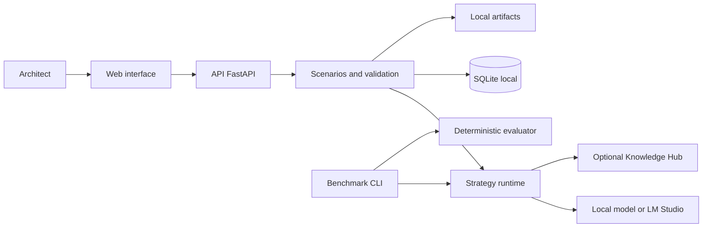

# ADR Forge

Local-first laboratory for analyzing architectural decisions, generating Architecture Decision
Records (ADRs), and reproducibly evaluating different language-model strategies.

ADR Forge compares baseline, structured prompting, context retrieval (RAG), fine-tuning, and hybrid
approaches. It organizes scenarios, maintains result traceability, and provides deterministic
validation and blind human comparison. The architect remains responsible for the final decision.


> [!IMPORTANT]
> This is an experimental, local application. It has no authentication or TLS and must remain bound
> to a loopback address. Do not expose it to a local network or the internet.

## Contents

- [Current status](#current-status)
- [Features](#features)
- [How the workflow works](#how-the-workflow-works)
- [Decision scope](#decision-scope)
- [Architecture](#architecture)
- [Quick start](#quick-start)
- [Getting started with the interface](#getting-started-with-the-interface)
- [API usage](#api-usage)
- [npm commands](#npm-commands)
- [Configuration](#configuration)
- [Manual execution](#manual-execution)
- [CLI](#cli)
- [Testing and quality](#testing-and-quality)
- [Docker](#docker)
- [Repository structure](#repository-structure)
- [Data, artifacts, and models](#data-artifacts-and-models)
- [Troubleshooting](#troubleshooting)
- [Security and limitations](#security-and-limitations)
- [Technical documentation](#technical-documentation)

## Current status

The primary local workflow, recovery safeguards, deterministic benchmark infrastructure, local
QLoRA smoke test, and the first baseline-versus-adapter run are implemented.

The result measured so far is **partial**. Both models produced a response, but neither returned
valid JSON within the smoke test's limited budget. Therefore, the experiment does not yet
demonstrate that fine-tuning improved quality. See the
[experiment report](docs/experiments/0002-baseline-vs-finetuned.md) for data, outputs, and
limitations.

## Features

- Creation and versioning of architectural scenarios.
- Scenario classification and identification of missing information.
- Generation of provisional or complete ADRs.
- Real-time run monitoring through Server-Sent Events (SSE).
- ADR export to Markdown.
- Fake strategies for development and testing without a GPU or network access.
- Context retrieval through immutable snapshots.
- Blind comparisons with human evaluation and subsequent provenance disclosure.
- Reproducible experiments and benchmarks.
- Validation and construction of governed datasets.
- Diagnostics for local resources, storage, and integrations.
- SQLite database backups and safe artifact maintenance.
- Opt-in QLoRA training with GPU resource safeguards.

## How the workflow works

1. The architect describes the problem, known facts, constraints, desired qualities, and candidate
   alternatives.
2. ADR Forge creates an immutable scenario revision and classifies its decision categories.
3. An available strategy analyzes that exact revision. RAG strategies also require a previously
   persisted retrieval snapshot.
4. The run publishes progress through SSE and preserves configuration, hashes, telemetry, and raw
   output.
5. The output is interpreted and validated against the ADR contract. A single repair attempt may
   occur when the structure is invalid.
6. The result ends as a complete ADR, a provisional ADR with up to three clarification questions,
   invalid output, failure, cancellation, or a recoverable interruption.
7. The ADR can be reviewed in the interface and exported as JSON or Markdown. Comparisons can hide
   strategy identities until the human evaluation is submitted.

### Included strategies

| ID                  | Approach                           | Runtime           | Additional requirement                |
| ------------------- | ---------------------------------- | ----------------- | ------------------------------------- |
| `fake-baseline`     | Deterministic development baseline | Local fake        | None                                  |
| `prompted`          | Deterministic structured prompt    | Local fake        | None                                  |
| `rag`               | Prompt with retrieved context      | Local fake        | Retrieval snapshot                    |
| `qwen3-4b-baseline` | Qwen without an adapter            | OpenAI-compatible | Configured LM Studio                  |
| `fine-tuned`        | Qwen with a verified adapter       | Transformers      | ML stack, model, and adapter manifest |
| `fine-tuned-rag`    | Adapter with retrieved context     | Transformers      | ML stack, adapter, and snapshot       |

The presence of a strategy in the API does not mean it is ready to run. Check
`GET /api/v1/strategies`: each item reports `available` and, when applicable, the reason it is
unavailable. A strategy is never silently replaced by another.

## Decision scope

The initial scope covers four categories:

- SQL versus NoSQL;
- synchronous versus asynchronous processing;
- modular monolith versus microservices;
- containers versus serverless versus traditional execution.

## Architecture



The application is a local modular monolith. The API hosts the use cases; SQLite stores metadata;
larger results are written as artifacts; and the React frontend consumes the API. Models, GPU use,
and external integrations are opt-in.

### Main technology stack

- Python 3.12, FastAPI, asynchronous SQLAlchemy, Alembic, Pydantic, and Typer;
- React 18, TypeScript, Vite, TanStack Query, and Vitest;
- SQLite for local metadata;
- PyTorch, Transformers, PEFT, and TRL as optional ML dependencies;
- Docker Compose for reproducible local builds.

## Quick start

### Prerequisites

- Python `>=3.12,<3.13`;
- [uv](https://docs.astral.sh/uv/);
- Node.js `>=22.12.0` and npm;
- Git;
- Docker with Compose, only for the optional container workflow.

A GPU, local model, and Knowledge Hub are **not required** to run CPU-safe tests or workflows that
use fake strategies.

### 1. Configure the environment

From the repository root:

```bash
cp .env.example .env
```

The resulting file contains safe local values. Only add tokens when using the corresponding
integration. Never commit `.env`.

### 2. Install dependencies and prepare the database

```bash
npm run setup
```

This command:

1. installs Python development dependencies with `uv`;
2. installs the root npm orchestrator;
3. installs frontend dependencies;
4. applies Alembic migrations.

### 3. Start the application

```bash
npm run dev
```

The command starts the API and frontend together. Press `Ctrl+C` to stop both.

### 4. Access the services

| Service      | URL                                      |
| ------------ | ---------------------------------------- |
| Web app      | <http://127.0.0.1:5173>                  |
| API          | <http://127.0.0.1:8000>                  |
| Swagger UI   | <http://127.0.0.1:8000/docs>             |
| ReDoc        | <http://127.0.0.1:8000/redoc>            |
| OpenAPI JSON | <http://127.0.0.1:8000/openapi.json>     |
| Health check | <http://127.0.0.1:8000/api/v1/health>    |
| Readiness    | <http://127.0.0.1:8000/api/v1/readiness> |

To quickly verify the API:

```bash
curl --fail http://127.0.0.1:8000/api/v1/health
```

Expected response:

```json
{ "status": "ok" }
```

## Getting started with the interface

1. Open **Testar IA** (Test AI) and select an available strategy.
2. Complete the scenario or use one of the SQL/NoSQL, monolith/microservices,
   synchronous/asynchronous, or containers/serverless examples.
3. Separate observed facts from constraints. The more measurable the latency, cost, deadline,
   volume, availability, and team-capacity limits are, the more auditable the ADR will be.
4. Start the analysis and monitor its stage and completion percentage.
5. Review assumptions, alternatives, consequences, risks, confidence, and review triggers before
   exporting. A generated recommendation is not an approved decision.

The **Treinamento** (Training) and **Base de dados** (Database) areas show the local status of their
respective artifacts; advanced, reproducible operations remain available through the CLI.

## API usage

The versioned API uses the `/api/v1` prefix, returns errors as `application/problem+json`, and
includes `X-Request-ID` in responses. The complete contract and payload schemas are available in
Swagger and the versioned OpenAPI file.

CPU-safe example using the fake strategy:

```bash
scenario_json="$(curl --fail-with-body --silent --show-error \
  http://127.0.0.1:8000/api/v1/scenarios \
  -H 'Content-Type: application/json' \
  --data '{
    "title": "Persistência para pagamentos",
    "language": "pt-BR",
    "problem": "Escolher a persistência do serviço de pagamentos e conciliação.",
    "facts": ["A equipe opera PostgreSQL", "Há exigência de auditoria"],
    "constraints": ["A entrega deve ocorrer em oito semanas"],
    "desired_qualities": ["consistência", "rastreabilidade"],
    "candidate_alternatives": ["PostgreSQL", "banco de documentos"]
  }')"

revision_id="$(printf '%s' "$scenario_json" | python3 -c \
  'import json,sys; print(json.load(sys.stdin)["current_revision"]["id"])')"

curl --fail-with-body http://127.0.0.1:8000/api/v1/analysis-runs \
  -H 'Content-Type: application/json' \
  --data "{\"scenario_revision_id\":\"$revision_id\",\"strategy_id\":\"fake-baseline\",\"strategy_version\":\"1\"}"
```

The `id` returned by the second call can be queried at `GET /api/v1/analysis-runs/{runId}`. Live
progress is available at `GET /api/v1/analysis-runs/{runId}/events`; the persisted run state remains
the source of truth after reconnection. Use Swagger at `/docs` to explore the complete API surface.

## npm commands

Run the commands below from the repository root.

| Command                | Description                                                 |
| ---------------------- | ----------------------------------------------------------- |
| `npm run setup`        | Installs Python/Node dependencies and applies migrations.   |
| `npm run migrate`      | Updates the local database to the latest migration.         |
| `npm run dev`          | Starts the API and frontend together with automatic reload. |
| `npm run api`          | Starts only the API at `127.0.0.1:8000`.                    |
| `npm run web`          | Starts only the frontend at `127.0.0.1:5173`.               |
| `npm run build`        | Validates TypeScript and creates the frontend build.        |
| `npm test`             | Runs CPU-safe Python tests and frontend tests.              |
| `npm run docker:build` | Builds the local images.                                    |
| `npm run docker:up`    | Starts local Compose. See the Docker limitations below.     |
| `npm run docker:down`  | Stops and removes the Compose containers.                   |

To list the scripts:

```bash
npm run
```

For an interactive selector, use `npx ntl`. This command may download the `ntl` package the first
time it runs.

## Configuration

The API reads `.env` from the repository root. Relative paths are also resolved from the root.

| Variable                                     | Default                                                   | Purpose                                    |
| -------------------------------------------- | --------------------------------------------------------- | ------------------------------------------ |
| `ADR_FORGE_HOST`                             | `127.0.0.1`                                               | API host; only loopback is accepted.       |
| `ADR_FORGE_PORT`                             | `8000`                                                    | API port.                                  |
| `ADR_FORGE_WEB_HOST`                         | `127.0.0.1`                                               | Host allowed by CORS.                      |
| `ADR_FORGE_WEB_PORT`                         | `5173`                                                    | Frontend port allowed by CORS.             |
| `ADR_FORGE_DATABASE_URL`                     | `sqlite+aiosqlite:///./data/adr-forge.sqlite3`            | Local SQLite database.                     |
| `ADR_FORGE_ARTIFACT_ROOT`                    | `./data/artifacts`                                        | Artifact directory.                        |
| `ADR_FORGE_ARTIFACT_WARNING_BYTES`           | `42949672960`                                             | Usage warning at 40 GiB.                   |
| `ADR_FORGE_ARTIFACT_LIMIT_BYTES`             | `53687091200`                                             | Maximum limit of 50 GiB.                   |
| `ADR_FORGE_ARTIFACT_FREE_DISK_RESERVE_BYTES` | `5368709120`                                              | Minimum reserve of 5 GiB free.             |
| `ADR_FORGE_DATASET_MANIFEST_PATH`            | `./datasets/manifests/v0.4.0-adr-dialogue.json`           | Manifest displayed as the current dataset. |
| `ADR_FORGE_DATASET_TRAINING_PATH`            | `./data/datasets/v0.4.0-adr-dialogue/training.jsonl`      | Locally built training dataset.            |
| `KNOWLEDGE_HUB_BASE_URL`                     | `http://127.0.0.1:8001`                                   | Local Knowledge Hub endpoint.              |
| `KNOWLEDGE_HUB_TOKEN`                        | empty                                                     | Optional Knowledge Hub bearer token.       |
| `HF_TOKEN`                                   | empty                                                     | Optional Hugging Face token.               |
| `HF_HOME`                                    | `./data/huggingface`                                      | Local model cache.                         |
| `ADR_FORGE_MODEL_ID`                         | `Qwen/Qwen3-4B-Instruct-2507`                             | Configured model.                          |
| `ADR_FORGE_MODEL_REVISION`                   | revision pinned in the example                            | Immutable model commit.                    |
| `ADR_FORGE_MODEL_TRUST_REMOTE_CODE`          | `false`                                                   | Must remain `false`.                       |
| `ADR_FORGE_ADAPTER_MANIFEST_PATH`            | `./data/training/qwen3-4b-adr-json/adapter-manifest.json` | Local fine-tuned adapter manifest.         |
| `ADR_FORGE_LM_STUDIO_BASE_URL`               | not set                                                   | Optional OpenAI-compatible endpoint.       |
| `ADR_FORGE_LM_STUDIO_MODEL_ID`               | not set                                                   | Identity of the model loaded in LM Studio. |
| `ADR_FORGE_LM_STUDIO_API_KEY`                | empty                                                     | Optional local runtime key.                |
| `ADR_FORGE_LM_STUDIO_TIMEOUT_SECONDS`        | `120`                                                     | Timeout between 1 and 300 seconds.         |

Relevant validation rules:

- API and frontend hosts must be loopback addresses (`127.0.0.1`, `localhost`, or equivalent);
- the artifact limit cannot exceed 50 GiB;
- the warning threshold must be lower than the limit;
- `trust_remote_code` must remain disabled;
- the LM Studio URL and model ID must be configured together;
- readiness requires an accessible artifact directory and at least 5 GiB of free space.

### Frontend and API URL

The frontend uses `VITE_API_BASE_URL`. The `npm run dev` shortcut already configures:

```text
http://127.0.0.1:8000/api/v1
```

When starting the frontend directly from `apps/web`, set the variable manually:

```bash
VITE_API_BASE_URL=http://127.0.0.1:8000/api/v1 npm --prefix apps/web run dev
```

## Manual execution

To control each process separately, apply the migrations first:

```bash
uv run alembic upgrade head
```

Terminal 1 — API:

```bash
uv run uvicorn apps.api.main:app --host 127.0.0.1 --port 8000 --reload
```

Terminal 2 — frontend:

```bash
VITE_API_BASE_URL=http://127.0.0.1:8000/api/v1 npm --prefix apps/web run dev
```

## CLI

The `adr-forge` executable is installed in the environment created by `uv`. Review the general or
subcommand help before advanced operations:

```bash
uv run adr-forge --help
uv run adr-forge doctor --help
```

### Diagnostics

```bash
uv run adr-forge doctor
uv run adr-forge doctor --json
```

The diagnostic command inspects storage, SQLite, CUDA/VRAM, GPU processes, the model, and
integrations without downloading models or modifying the system.

### Dataset

```bash
uv run adr-forge dataset validate --manifest datasets/manifests/v0.1.0.json
uv run adr-forge dataset build \
  --manifest datasets/manifests/v0.1.0.json \
  --output data/datasets/v0.1.0/training.jsonl
```

### Benchmark

```bash
uv run adr-forge benchmark run --config configs/evaluation/smoke.yaml
uv run adr-forge benchmark report --experiment <UUID> --output data/reports/report.md
```

Use `--help` to confirm the available configuration files and resume options.

### Opt-in training

```bash
uv sync --frozen --extra dev --extra ml
uv run adr-forge dataset build \
  --manifest datasets/manifests/v0.3.0-adr-contract.json \
  --output data/datasets/v0.3.0-adr-contract/training.jsonl
uv run adr-forge train sft --config configs/training/qwen3-4b-adr-contract-v3.yaml
```

The recommended dataset for conversational training is version `v0.4.0`, which includes proposed
ADRs, provisional ADRs, and clarification continuations validated by the domain contract:

```bash
uv run adr-forge dataset validate \
  --manifest datasets/manifests/v0.4.0-adr-dialogue.json
uv run adr-forge dataset build \
  --manifest datasets/manifests/v0.4.0-adr-dialogue.json \
  --output data/datasets/v0.4.0-adr-dialogue/training.jsonl
uv run adr-forge train sft --config configs/training/qwen3-4b-adr-dialogue-v4.yaml
```

Training requires the optional ML stack, an available model, and a compatible GPU. The smoke test
is not a quality training dataset; it exists solely to validate the pipeline.

The `qwen3-4b-adr-contract-v3` profile trains a single `snake_case` JSON contract for the ADR,
including provisional questions in `unresolved_questions`. Validation remains strict: outputs that
violate the contract are rejected and must be corrected in the dataset, not adapted in the API.

### Database and artifacts

```bash
uv run adr-forge database backup --output data/backups/adr-forge.sqlite3
uv run adr-forge artifacts list
uv run adr-forge artifacts prune
uv run adr-forge artifacts prune --confirm
```

The backup does not silently overwrite an existing destination. Artifact removal requires
`--confirm` and considers only eligible items without active references.

## Testing and quality

The quick shortcut runs Python tests that do not use a GPU or live integrations, followed by the
frontend tests:

```bash
npm test
```

The project's complete quality gates are:

```bash
uv run ruff format --check .
uv run ruff check .
uv run mypy src apps/api
uv run pytest tests/contract/test_openapi_compatibility.py -q
uv run pytest -m "not gpu and not live_integration"
npm --prefix apps/web run lint
npm --prefix apps/web run format:check
npm --prefix apps/web test
npm --prefix apps/web run build
npm --prefix apps/web run test:e2e
```

The Python gate can be reproduced with `scripts/verify-python-ci.sh`. CI automation also checks
dataset fixture integrity, secret leakage, Python dependencies, and npm dependencies. Review the
versioned workflows before reproducing checks that may query external vulnerability databases.

The current Playwright test is a smoke test of the interface shell: it starts Vite automatically
but does not cover an integrated API workflow. It requires an installed browser. To install
Chromium locally:

```bash
npm --prefix apps/web exec playwright install chromium
```

Tests marked `gpu` or `live_integration` are deliberately opt-in:

```bash
uv run pytest -m gpu
uv run pytest -m live_integration
```

Do not run these groups without explicitly preparing the hardware, model, or integration.

## Docker

To build the CPU-safe images:

```bash
npm run docker:build
```

To start and stop Compose:

```bash
npm run docker:up
npm run docker:down
```

Compose exposes only:

- `127.0.0.1:8000` for the API;
- `127.0.0.1:5173` for the frontend.

The database and API artifacts are stored in `./data`, mounted at `/app/data` in the container, and
CUDA remains disabled in the container.

> [!WARNING]
> The current Compose setup is intended for image building and reproducibility. It does not yet run
> Alembic migrations automatically, and the web image has no `/api/v1` proxy to the API. Therefore,
> prefer `npm run dev` when validating the local end-to-end workflow.

These containers are exclusively local. They must not be used to start, stop, recreate, diagnose,
or deploy production services.

## Repository structure

```text
adr-forge/
├── alembic/                 # Database migrations
├── apps/
│   ├── api/                 # FastAPI composition root
│   └── web/                 # React/Vite application
├── configs/                 # Model, training, and evaluation configuration
├── datasets/                # Fixtures, manifests, schemas, and governed public data
├── docs/
│   ├── adrs/                # Accepted architectural decisions
│   ├── architecture/        # Blueprint and quality gates
│   └── experiments/         # Experimental reports and evidence
├── specs/                   # Specification, plan, contracts, and tasks
├── src/adr_forge/           # Domain, use cases, adapters, and CLI
├── tests/                   # Unit, integration, contract, and security tests
├── data/                    # Generated local state ignored by Git
├── .env.example             # Local configuration template
├── compose.yaml             # Local CPU-safe services
├── package.json             # Root development shortcuts
└── pyproject.toml           # Python package and tooling
```

## Data, artifacts, and models

- Local metadata is stored in `data/adr-forge.sqlite3` by default.
- Outputs, snapshots, and evidence are stored in `data/artifacts`.
- The Hugging Face cache is stored in `data/huggingface`.
- Training data is versioned and governed separately from fixed evaluation scenarios.
- Runs preserve the scenario, strategy, configuration, raw output, telemetry, and validation
  findings.
- Retrieval snapshots are persisted to prevent a repeated run from silently querying different
  content.
- `.env`, tokens, databases, models, snapshots, and artifacts must not be versioned.

## Troubleshooting

### `npm run dev` cannot find `concurrently`

Install the root dependencies:

```bash
npm ci
```

Or repeat the complete setup:

```bash
npm run setup
```

### The API reports that a table does not exist

The migrations probably have not been applied:

```bash
npm run migrate
```

### The interface opens, but `/api/v1` calls fail

Use the root shortcut, which configures the API URL:

```bash
npm run dev
```

If starting Vite manually, set `VITE_API_BASE_URL` as shown in the configuration section.

### Port 8000 or 5173 is already in use

Identify the process using the port and terminate it intentionally. If you change the ports, update
`ADR_FORGE_PORT`, `ADR_FORGE_WEB_PORT`, the Vite command, and `VITE_API_BASE_URL` together; CORS
depends on these values.

### Readiness returns HTTP 503

Check:

```bash
uv run adr-forge doctor
```

The artifact directory must be writable, and the disk must retain the configured minimum reserve
of 5 GiB.

### Knowledge Hub appears as not configured

Set `KNOWLEDGE_HUB_TOKEN` in `.env`. This integration is optional; fake workflows remain available
without it.

### GPU or video-memory issues

Remove competing models from the GPU, review the diagnostics, and run only the specific test:

```bash
uv run adr-forge doctor
uv run pytest -m gpu tests/integration/test_qwen_qlora_smoke.py
```

Do not include GPU tests in the CPU-safe routine.

## Security and limitations

- The application provides neither authentication nor TLS.
- The API and frontend must remain on loopback addresses.
- Tokens are treated as secrets and must not appear in logs, artifacts, or commits.
- Models and external integrations are opt-in.
- Configuration prohibits `trust_remote_code`.
- Training and benchmarking use an exclusive lease on the local GPU.
- Automated validation checks structure and traceability; it does not replace human review.
- The first experiment does not support a claim that the adapter improved quality.
- A scientific conclusion requires a larger held-out set, valid structured outputs, and blind human
  evaluation.

## Technical documentation

- [Product specification](specs/001-architecture-decision-lab/spec.md)
- [Technical plan](specs/001-architecture-decision-lab/plan.md)
- [Data model](specs/001-architecture-decision-lab/data-model.md)
- [Validation quick start](specs/001-architecture-decision-lab/quickstart.md)
- [OpenAPI contract](specs/001-architecture-decision-lab/contracts/api.openapi.yaml)
- [CLI contract](specs/001-architecture-decision-lab/contracts/cli.md)
- [Knowledge Hub integration](specs/001-architecture-decision-lab/contracts/knowledge-hub.md)
- [Architecture blueprint](docs/architecture/blueprint.md)
- [Quality gates](docs/architecture/quality-gates.md)
- [Accepted ADRs](docs/adrs/README.md)
- [Local smoke-test report](docs/experiments/0001-local-smoke.md)
- [Baseline versus fine-tuned comparison](docs/experiments/0002-baseline-vs-finetuned.md)

Development follows the versioned specification, planning, and task artifacts. A task should only
be marked complete after its relevant validations pass.
