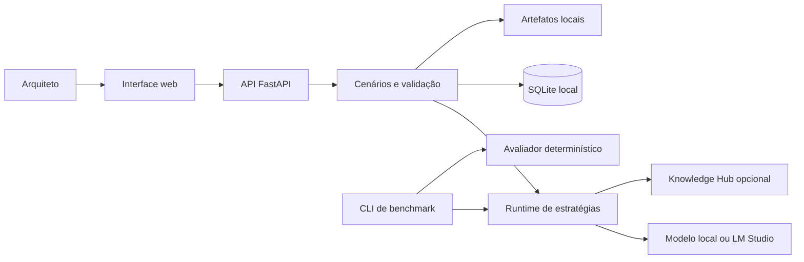

# ADR Forge

Laboratório local-first para análise de decisões arquiteturais, geração de Architecture Decision
Records (ADRs) e avaliação reproduzível de diferentes estratégias de uso de modelos de linguagem.

O ADR Forge compara abordagens baseline, prompt estruturado, recuperação de contexto (RAG),
fine-tuning e estratégias híbridas. A ferramenta organiza cenários, mantém rastreabilidade dos
resultados e oferece validação determinística e comparação humana cega. A decisão final continua
sendo responsabilidade do arquiteto.

> [!IMPORTANT]
> Este é um projeto experimental e local. A aplicação não possui autenticação nem TLS e deve
> permanecer vinculada ao endereço de loopback. Não a exponha na rede local ou na internet.

## Conteúdo

- [Estado atual](#estado-atual)
- [Funcionalidades](#funcionalidades)
- [Escopo de decisões](#escopo-de-decisões)
- [Arquitetura](#arquitetura)
- [Início rápido](#início-rápido)
- [Comandos npm](#comandos-npm)
- [Configuração](#configuração)
- [Execução manual](#execução-manual)
- [CLI](#cli)
- [Testes e qualidade](#testes-e-qualidade)
- [Docker](#docker)
- [Estrutura do repositório](#estrutura-do-repositório)
- [Dados, artefatos e modelos](#dados-artefatos-e-modelos)
- [Solução de problemas](#solução-de-problemas)
- [Segurança e limitações](#segurança-e-limitações)
- [Documentação técnica](#documentação-técnica)

## Estado atual

O fluxo local principal, as proteções de recuperação, a infraestrutura determinística de
benchmark, o smoke test local de QLoRA e a primeira execução baseline versus adapter estão
implementados.

O resultado medido até agora é **parcial**. Os dois modelos produziram uma resposta, mas nenhum
retornou JSON válido dentro do orçamento reduzido do smoke test. Portanto, o experimento ainda não
demonstra que o fine-tuning melhorou a qualidade. Consulte o
[relatório do experimento](docs/experiments/0002-baseline-vs-finetuned.md) para ver dados, saídas e
limitações.

## Funcionalidades

- Cadastro e versionamento de cenários arquiteturais.
- Classificação de cenários e identificação de informações ausentes.
- Geração de ADRs provisórios ou completos.
- Acompanhamento de execução em tempo real por Server-Sent Events (SSE).
- Exportação de ADRs em Markdown.
- Estratégias fake para desenvolvimento e testes sem GPU ou acesso à rede.
- Recuperação de contexto por snapshots imutáveis.
- Comparações cegas com avaliação humana e revelação posterior da proveniência.
- Experimentos e benchmarks reproduzíveis.
- Validação e construção de datasets governados.
- Diagnóstico de recursos locais, armazenamento e integrações.
- Backup do banco SQLite e manutenção segura de artefatos.
- Treinamento QLoRA opt-in com proteção de recursos da GPU.

## Escopo de decisões

O escopo inicial cobre quatro categorias:

- SQL versus NoSQL;
- processamento síncrono versus assíncrono;
- monólito modular versus microsserviços;
- contêineres versus serverless versus execução tradicional.

## Arquitetura



A aplicação é um monólito modular local. A API concentra os casos de uso; SQLite armazena os
metadados; resultados maiores são gravados como artefatos; o frontend React consome a API. Modelos,
GPU e integrações externas são opt-in.

### Stack principal

- Python 3.12, FastAPI, SQLAlchemy assíncrono, Alembic, Pydantic e Typer;
- React 18, TypeScript, Vite, TanStack Query e Vitest;
- SQLite para metadados locais;
- PyTorch, Transformers, PEFT e TRL como dependências opcionais de ML;
- Docker Compose para builds locais reproduzíveis.

## Início rápido

### Pré-requisitos

- Python `>=3.12,<3.13`;
- [uv](https://docs.astral.sh/uv/);
- Node.js `>=22.12.0` e npm;
- Git;
- Docker com Compose apenas para o fluxo opcional de contêineres.

GPU, modelo local e Knowledge Hub **não são necessários** para executar os testes CPU-safe nem os
fluxos que usam estratégias fake.

### 1. Configure o ambiente

Na raiz do repositório:

```bash
cp .env.example .env
```

O arquivo criado contém valores locais seguros. Preencha tokens apenas se for utilizar a integração
correspondente. Nunca faça commit do `.env`.

### 2. Instale as dependências e prepare o banco

```bash
npm run setup
```

Esse comando:

1. instala as dependências Python de desenvolvimento com `uv`;
2. instala o orquestrador npm da raiz;
3. instala as dependências do frontend;
4. aplica as migrações do Alembic.

### 3. Inicie a aplicação

```bash
npm run dev
```

O comando inicia API e frontend juntos. Pressione `Ctrl+C` para encerrar ambos.

### 4. Acesse os serviços

| Serviço | URL |
|---|---|
| Aplicação web | <http://127.0.0.1:5173> |
| API | <http://127.0.0.1:8000> |
| Swagger UI | <http://127.0.0.1:8000/docs> |
| ReDoc | <http://127.0.0.1:8000/redoc> |
| OpenAPI JSON | <http://127.0.0.1:8000/openapi.json> |
| Health check | <http://127.0.0.1:8000/api/v1/health> |
| Readiness | <http://127.0.0.1:8000/api/v1/readiness> |

Para verificar rapidamente a API:

```bash
curl --fail http://127.0.0.1:8000/api/v1/health
```

Resposta esperada:

```json
{"status":"ok"}
```

## Comandos npm

Execute os comandos abaixo na raiz do repositório.

| Comando | Descrição |
|---|---|
| `npm run setup` | Instala dependências Python/Node e aplica as migrações. |
| `npm run migrate` | Atualiza o banco local até a última migração. |
| `npm run dev` | Inicia API e frontend juntos, com recarga automática. |
| `npm run api` | Inicia somente a API em `127.0.0.1:8000`. |
| `npm run web` | Inicia somente o frontend em `127.0.0.1:5173`. |
| `npm run build` | Valida o TypeScript e gera o build do frontend. |
| `npm test` | Executa testes Python CPU-safe e testes do frontend. |
| `npm run docker:build` | Constrói as imagens locais. |
| `npm run docker:up` | Inicia o Compose local. Consulte as limitações de Docker abaixo. |
| `npm run docker:down` | Encerra e remove os contêineres do Compose. |

Para listar os scripts:

```bash
npm run
```

Se preferir um seletor interativo, use `npx ntl`. Esse comando pode baixar o pacote `ntl` na
primeira execução.

## Configuração

A API lê o `.env` localizado na raiz. Os caminhos relativos também são resolvidos a partir da raiz.

| Variável | Padrão | Finalidade |
|---|---|---|
| `ADR_FORGE_HOST` | `127.0.0.1` | Host da API; somente loopback é aceito. |
| `ADR_FORGE_PORT` | `8000` | Porta da API. |
| `ADR_FORGE_WEB_HOST` | `127.0.0.1` | Host autorizado pelo CORS. |
| `ADR_FORGE_WEB_PORT` | `5173` | Porta do frontend autorizada pelo CORS. |
| `ADR_FORGE_DATABASE_URL` | `sqlite+aiosqlite:///./data/adr-forge.sqlite3` | Banco SQLite local. |
| `ADR_FORGE_ARTIFACT_ROOT` | `./data/artifacts` | Diretório de artefatos. |
| `ADR_FORGE_ARTIFACT_WARNING_BYTES` | `42949672960` | Alerta de uso em 40 GiB. |
| `ADR_FORGE_ARTIFACT_LIMIT_BYTES` | `53687091200` | Limite máximo de 50 GiB. |
| `KNOWLEDGE_HUB_BASE_URL` | `http://127.0.0.1:8001` | Endpoint local do Knowledge Hub. |
| `KNOWLEDGE_HUB_TOKEN` | vazio | Bearer token opcional do Knowledge Hub. |
| `HF_TOKEN` | vazio | Token opcional do Hugging Face. |
| `HF_HOME` | `./data/huggingface` | Cache local de modelos. |
| `ADR_FORGE_MODEL_ID` | `Qwen/Qwen3-4B-Instruct-2507` | Modelo configurado. |
| `ADR_FORGE_MODEL_REVISION` | revisão fixada no exemplo | Commit imutável do modelo. |
| `ADR_FORGE_MODEL_TRUST_REMOTE_CODE` | `false` | Deve permanecer `false`. |
| `ADR_FORGE_LM_STUDIO_BASE_URL` | não definido | Endpoint OpenAI-compatible opcional. |
| `ADR_FORGE_LM_STUDIO_MODEL_ID` | não definido | Identidade do modelo carregado no LM Studio. |
| `ADR_FORGE_LM_STUDIO_API_KEY` | vazio | Chave opcional do runtime local. |
| `ADR_FORGE_LM_STUDIO_TIMEOUT_SECONDS` | `120` | Timeout entre 1 e 300 segundos. |

Regras de validação relevantes:

- hosts da API e do frontend devem ser loopback (`127.0.0.1`, `localhost` ou equivalente);
- o limite de artefatos não pode ultrapassar 50 GiB;
- o limiar de alerta deve ser menor que o limite;
- `trust_remote_code` deve permanecer desabilitado;
- URL e ID do modelo do LM Studio devem ser configurados juntos;
- o readiness exige o diretório de artefatos acessível e pelo menos 5 GiB livres.

### Frontend e URL da API

O frontend usa `VITE_API_BASE_URL`. O atalho `npm run dev` já configura:

```text
http://127.0.0.1:8000/api/v1
```

Ao iniciar o frontend diretamente dentro de `apps/web`, defina a variável manualmente:

```bash
VITE_API_BASE_URL=http://127.0.0.1:8000/api/v1 npm --prefix apps/web run dev
```

## Execução manual

Se quiser controlar cada processo separadamente, primeiro aplique as migrações:

```bash
uv run alembic upgrade head
```

Terminal 1 — API:

```bash
uv run uvicorn apps.api.main:app --host 127.0.0.1 --port 8000 --reload
```

Terminal 2 — frontend:

```bash
VITE_API_BASE_URL=http://127.0.0.1:8000/api/v1 npm --prefix apps/web run dev
```

## CLI

O executável `adr-forge` é instalado no ambiente criado pelo `uv`. Consulte a ajuda geral ou de um
subcomando antes de operações avançadas:

```bash
uv run adr-forge --help
uv run adr-forge doctor --help
```

### Diagnóstico

```bash
uv run adr-forge doctor
uv run adr-forge doctor --json
```

O diagnóstico inspeciona armazenamento, SQLite, CUDA/VRAM, processos de GPU, modelo e integrações
sem baixar modelos ou alterar o sistema.

### Dataset

```bash
uv run adr-forge dataset validate --manifest datasets/manifests/v0.1.0.json
uv run adr-forge dataset build \
  --manifest datasets/manifests/v0.1.0.json \
  --output data/datasets/v0.1.0/training.jsonl
```

### Benchmark

```bash
uv run adr-forge benchmark run --config configs/evaluation/smoke.yaml
uv run adr-forge benchmark report --experiment <UUID> --output data/reports/report.md
```

Use `--help` para confirmar os arquivos de configuração disponíveis e as opções de retomada.

### Treinamento opt-in

```bash
uv sync --frozen --extra dev --extra ml
uv run adr-forge dataset build \
  --manifest datasets/manifests/v0.2.0-adr-json.json \
  --output data/datasets/v0.2.0-adr-json/training.jsonl
uv run adr-forge train sft --config configs/training/qwen3-4b-adr-json.yaml
```

O treinamento requer o stack opcional de ML, modelo disponível e GPU compatível. O smoke test não é
um dataset de qualidade para treinamento; ele existe apenas para validar o pipeline.

O perfil `qwen3-4b-adr-json` treina o contrato de saída JSON do ADR e produz respostas
provisórias quando faltam fatos e restrições. Decisões conclusivas de alta qualidade exigem
exemplos ADR completos, revisados e com contexto estruturado.

### Banco e artefatos

```bash
uv run adr-forge database backup --output data/backups/adr-forge.sqlite3
uv run adr-forge artifacts list
uv run adr-forge artifacts prune
uv run adr-forge artifacts prune --confirm
```

O backup não sobrescreve silenciosamente um destino existente. A remoção de artefatos exige
`--confirm` e considera apenas itens elegíveis e sem referência ativa.

## Testes e qualidade

O atalho rápido executa testes Python que não usam GPU nem integrações ao vivo e, em seguida, os
testes do frontend:

```bash
npm test
```

Os quality gates completos usados pelo projeto são:

```bash
uv run ruff format --check .
uv run ruff check .
uv run mypy src apps/api
uv run pytest tests/contract/test_openapi_compatibility.py -q
uv run pytest -m "not gpu and not live_integration"
npm --prefix apps/web run lint
npm --prefix apps/web run format:check
npm --prefix apps/web test
npm --prefix apps/web run build
```

Os testes marcados como `gpu` ou `live_integration` são deliberadamente opt-in:

```bash
uv run pytest -m gpu
uv run pytest -m live_integration
```

Não execute esses grupos sem preparar explicitamente o hardware, o modelo ou a integração.

## Docker

Para construir as imagens CPU-safe:

```bash
npm run docker:build
```

Para iniciar e encerrar o Compose:

```bash
npm run docker:up
npm run docker:down
```

O Compose publica apenas:

- `127.0.0.1:8000` para a API;
- `127.0.0.1:5173` para o frontend.

O banco e os artefatos da API são mantidos em `./data`, montado em `/app/data` no contêiner, e
CUDA permanece desabilitada no contêiner.

> [!WARNING]
> O Compose atual é voltado à construção e reprodutibilidade das imagens. Ele ainda não executa as
> migrações Alembic automaticamente e a imagem web não possui proxy `/api/v1` para a API. Portanto,
> prefira `npm run dev` para validar o fluxo end-to-end local.

Esses contêineres são exclusivamente locais. Eles não devem ser usados para iniciar, parar,
recriar, diagnosticar ou implantar serviços de produção.

## Estrutura do repositório

```text
adr-forge/
├── alembic/                 # Migrações do banco
├── apps/
│   ├── api/                 # Composition root da API FastAPI
│   └── web/                 # Aplicação React/Vite
├── configs/                 # Configurações de modelos, treino e avaliação
├── datasets/                # Fixtures, manifests, schemas e dados públicos governados
├── docs/
│   ├── adrs/                # Decisões arquiteturais aceitas
│   ├── architecture/        # Blueprint e quality gates
│   └── experiments/         # Relatórios e evidências experimentais
├── specs/                   # Especificação, plano, contratos e tarefas
├── src/adr_forge/           # Domínio, casos de uso, adaptadores e CLI
├── tests/                   # Testes unitários, integração, contrato e segurança
├── data/                    # Estado local gerado e ignorado pelo Git
├── .env.example             # Modelo de configuração local
├── compose.yaml             # Serviços locais CPU-safe
├── package.json             # Atalhos de desenvolvimento da raiz
└── pyproject.toml           # Pacote e ferramentas Python
```

## Dados, artefatos e modelos

- Metadados locais ficam em `data/adr-forge.sqlite3` por padrão.
- Saídas, snapshots e evidências ficam em `data/artifacts`.
- O cache do Hugging Face fica em `data/huggingface`.
- Dados de treinamento são versionados e governados separadamente dos cenários fixos de avaliação.
- Execuções preservam cenário, estratégia, configuração, saída bruta, telemetria e achados de
  validação.
- Snapshots de recuperação são persistidos para impedir que uma repetição consulte silenciosamente
  conteúdo diferente.
- `.env`, tokens, bancos, modelos, snapshots e artefatos não devem ser versionados.

## Solução de problemas

### `npm run dev` não encontra `concurrently`

Instale as dependências da raiz:

```bash
npm ci
```

Ou refaça a preparação completa:

```bash
npm run setup
```

### A API informa que uma tabela não existe

As migrações provavelmente não foram aplicadas:

```bash
npm run migrate
```

### A interface abre, mas as chamadas `/api/v1` falham

Use o atalho da raiz, que configura a URL da API:

```bash
npm run dev
```

Se estiver iniciando o Vite manualmente, defina `VITE_API_BASE_URL` conforme mostrado na seção de
configuração.

### A porta 8000 ou 5173 já está ocupada

Descubra o processo que está usando a porta e encerre-o conscientemente. Se alterar as portas,
atualize em conjunto `ADR_FORGE_PORT`, `ADR_FORGE_WEB_PORT`, o comando do Vite e
`VITE_API_BASE_URL`; o CORS depende desses valores.

### O readiness retorna HTTP 503

Verifique:

```bash
uv run adr-forge doctor
```

O diretório de artefatos precisa ser gravável e o disco deve manter a reserva mínima configurada
de 5 GiB.

### Knowledge Hub aparece como não configurado

Defina `KNOWLEDGE_HUB_TOKEN` no `.env`. O uso dessa integração é opcional; os fluxos fake continuam
disponíveis sem ela.

### Problemas com GPU ou memória de vídeo

Remova modelos concorrentes da GPU, confira o diagnóstico e execute somente o teste específico:

```bash
uv run adr-forge doctor
uv run pytest -m gpu tests/integration/test_qwen_baseline.py
```

Não inclua os testes de GPU na rotina CPU-safe.

## Segurança e limitações

- A aplicação não oferece autenticação nem TLS.
- API e frontend devem permanecer em loopback.
- Tokens são tratados como segredos e não devem aparecer em logs, artefatos ou commits.
- Modelos e integrações externas são opt-in.
- `trust_remote_code` é proibido pela configuração.
- Treino e benchmark usam uma concessão exclusiva da GPU local.
- Validações automáticas verificam estrutura e rastreabilidade; não substituem revisão humana.
- O primeiro experimento não sustenta uma alegação de ganho de qualidade do adapter.
- Uma conclusão científica exige conjunto retido maior, saídas estruturadas válidas e avaliação
  humana cega.

## Documentação técnica

- [Especificação do produto](specs/001-architecture-decision-lab/spec.md)
- [Plano técnico](specs/001-architecture-decision-lab/plan.md)
- [Modelo de dados](specs/001-architecture-decision-lab/data-model.md)
- [Quickstart de validação](specs/001-architecture-decision-lab/quickstart.md)
- [Contrato OpenAPI](specs/001-architecture-decision-lab/contracts/api.openapi.yaml)
- [Contrato da CLI](specs/001-architecture-decision-lab/contracts/cli.md)
- [Integração com Knowledge Hub](specs/001-architecture-decision-lab/contracts/knowledge-hub.md)
- [Blueprint de arquitetura](docs/architecture/blueprint.md)
- [Quality gates](docs/architecture/quality-gates.md)
- [ADRs aceitos](docs/adrs/README.md)
- [Relatório do smoke test local](docs/experiments/0001-local-smoke.md)
- [Comparação baseline versus fine-tuned](docs/experiments/0002-baseline-vs-finetuned.md)

O desenvolvimento segue os artefatos versionados de especificação, planejamento e tarefas. Uma
tarefa só deve ser marcada como concluída depois que suas validações relevantes passarem.
