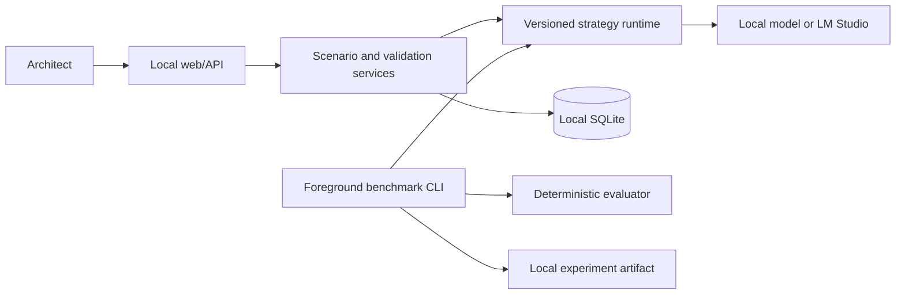

# ADR Forge

ADR Forge is a local-first fine-tuning laboratory for architecture decision analysis and
Architecture Decision Record (ADR) generation.

The project investigates whether a fine-tuned language model can produce more consistent, traceable, and useful ADR drafts than prompting or retrieval alone. It is designed for experienced software architects and keeps final decision accountability with the human reviewer.

## Initial scope

- SQL versus NoSQL
- Synchronous versus asynchronous processing
- Modular monolith versus microservices
- Containers versus serverless versus traditional execution

The laboratory will compare baseline, structured-prompt, retrieval-assisted, fine-tuned, and hybrid strategies using reproducible benchmarks, deterministic validation, and blind human evaluation.

## Status

The core local workflow, recovery gates, deterministic benchmark infrastructure, local QLoRA smoke,
and the first baseline-versus-adapter execution are implemented. The measured comparison is
**partial**: both models generated a response, but neither returned valid JSON under the bounded
smoke budget. It is not evidence that fine-tuning improved quality. See the
[experiment report](docs/experiments/0002-baseline-vs-finetuned.md).

The product specification is available in
[`specs/001-architecture-decision-lab/spec.md`](specs/001-architecture-decision-lab/spec.md), with
the technical plan in
[`specs/001-architecture-decision-lab/plan.md`](specs/001-architecture-decision-lab/plan.md) and
the delivery tasks in
[`specs/001-architecture-decision-lab/tasks.md`](specs/001-architecture-decision-lab/tasks.md).

## Local setup

Requirements:

- Python 3.12 and [uv](https://docs.astral.sh/uv/)
- Node.js 22 and npm
- Docker with Compose only if you want to exercise the CPU-safe container build

Install the Python and frontend toolchains without the optional model stack:

```bash
uv sync --frozen --extra dev
cd apps/web
npm ci
```

Copy `.env.example` to `.env` and add local credentials only when an integration needs them. Never
commit `.env`, tokens, model files, databases, retrieval snapshots, or experiment artifacts.

Run the local development shells in separate terminals:

```bash
uv run uvicorn apps.api.main:app --host 127.0.0.1 --port 8000
cd apps/web && npm run dev
```

Both processes bind to loopback. The MVP has no authentication or TLS and must not be exposed on a
LAN or the public internet.

## Architecture



The runtime is deliberately local-first: the API binds to loopback, model execution is opt-in, and
training/benchmark jobs use an exclusive local GPU lease. Consult
[the architecture blueprint](docs/architecture/blueprint.md) and
[accepted ADRs](docs/adrs/README.md) for the decisions behind these boundaries.

## Dataset and evaluation methodology

Training data is versioned and governed separately from fixed evaluation scenarios. Benchmark
outputs retain scenario, strategy, generation configuration, raw output, telemetry, and deterministic
validation findings. Human review remains the authority for architectural decisions; automated checks
measure structure and traceability only.

The opt-in QLoRA smoke uses a one-example fixture solely to validate the local pipeline. It is not a
training-quality dataset. Details and hardware evidence are in
[local smoke 0001](docs/experiments/0001-local-smoke.md).

## Measured local result and limitations

The first offline GPU comparison used Qwen3 4B in NF4 4-bit on an RTX 3060. The baseline generated
64 tokens in 5.573 s and the smoke adapter in 4.002 s; both outputs were Markdown rather than the
required JSON and therefore failed deterministic validation. The complete evidence, including raw
outputs and failure accounting, is in
[experiment 0002](docs/experiments/0002-baseline-vs-finetuned.md).

Consequently, ADR Forge makes no claim that the adapter is more accurate, useful, or generally
better. A larger held-out evaluation set, compliant structured outputs, and blind human comparison
are required before such a claim.

## Quality gates

The default gates are CPU-only and never download or load a language model:

```bash
uv run ruff format --check .
uv run ruff check .
uv run mypy src apps/api
uv run pytest -m "not gpu and not live_integration"
cd apps/web
npm run lint
npm run format:check
npm test
npm run build
```

GPU and live-integration tests are opt-in through the `gpu` and `live_integration` Pytest markers.

## Reproducible container build

`docker compose build` creates CPU-safe API and static web images. `docker compose up` publishes
only `127.0.0.1:8000` and `127.0.0.1:5173`. Native host execution remains the supported future GPU
path.

These containers are for local development and reproducibility only. They must not be used to
deploy, start, stop, recreate, or diagnose production services. Production is outside this local
workspace and requires an explicitly configured remote connection.

## Architecture and workflow

- [Architecture blueprint](docs/architecture/blueprint.md)
- [Quality gates](docs/architecture/quality-gates.md)
- [Accepted architecture decisions](docs/adrs/README.md)
- [Spec Kit workflow and task ordering](specs/001-architecture-decision-lab/tasks.md)

Work proceeds phase by phase from the checked-in specification, plan, contracts, and task list.
Completed tasks are marked in `tasks.md` only after their relevant validation passes.
