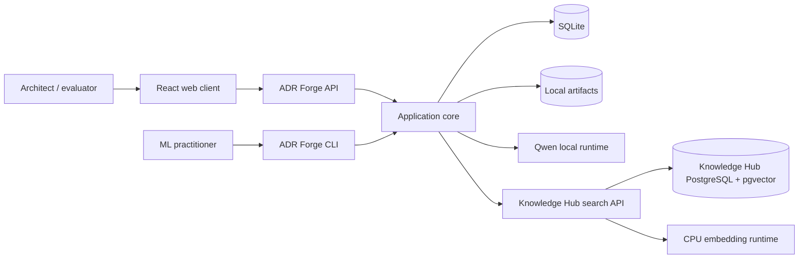
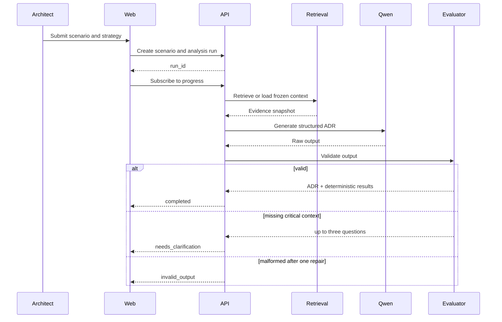

# ADR Forge Architecture Blueprint

- **Version**: 1.0
- **Date**: 2026-10-10
- **Status**: Accepted
- **Owner and decision maker**: Marcelo Soiber
- **Scope horizon**: Local MVP through first reproducible fine-tuning benchmark
- **Confidence**: High for product and module boundaries; medium for measured QLoRA capacity until the first smoke run

## 1. Executive Summary

ADR Forge is a local-first laboratory that helps experienced architects produce reviewable ADR
drafts and measures whether supervised QLoRA fine-tuning improves architectural analysis over
prompting and RAG baselines. It uses a modular Python monolith with a React client, SQLite metadata,
filesystem artifacts, one exclusive local GPU, and the existing Knowledge Hub for retrieval. The
main benefit is an honest, reproducible comparison pipeline; the main trade-off is sequential local
execution and potentially long inference. The first milestone is a vertical slice that creates one
scenario, runs one Qwen baseline, validates its ADR, displays progress, and exports Markdown.

## 2. Context, Scope, and Objectives

For experienced software architects, ADR Forge turns a constrained architecture scenario into a
traceable ADR draft while preserving human accountability. It also serves the project owner as an
ML laboratory for dataset curation, QLoRA training, deterministic evaluation, blind review, and
portfolio evidence.

Initial categories are SQL versus NoSQL, synchronous versus asynchronous processing, modular
monolith versus microservices, and containers versus serverless versus traditional execution.

Out of scope are autonomous approval, production deployment, multiple users, training a foundation
model, private workplace data, code generation, organization-wide authorization, and architecture
categories beyond the initial four.

## 3. Facts, Assumptions, Constraints, and Open Items

| Type | Item | Evidence/confidence | Impact or action |
| --- | --- | --- | --- |
| Fact | Workstation has RTX 3060 with 12 GB VRAM and 30 GB RAM | Observed locally | One quantized GPU workload at a time |
| Fact | GPT-OSS in LM Studio currently occupies most GPU memory | Observed `llama-server` usage | Unload it before Qwen inference/training |
| Fact | Knowledge Hub exposes authenticated hybrid search | Existing repository | Reuse it through REST |
| Decision | Localhost-only single-user MVP | User confirmed | No authentication in MVP |
| Decision | Public dataset contains only authorized reviewed content | User confirmed | Provenance and sensitive-data gates |
| Decision | Native host GPU execution, Docker for CPU builds | User confirmed | CI excludes live GPU work |
| Assumption | Future GitLab VM has no usable GPU | Medium | Run fake/snapshot validation until verified |
| Open, non-blocking | Exact QLoRA batch, rank, context, and training duration | Must be measured | Resolve through smoke configurations, not architecture guesses |

## 4. Quality Attributes

| ID | Attribute | Target | Verification | Priority |
| --- | --- | --- | --- | --- |
| NFR-001 | Progress responsiveness | Request acknowledged within 1 second | API integration test | Must |
| NFR-002 | Analysis duration | Long-running accepted; initial p95 observation target 90 seconds | Local benchmark | Should |
| NFR-003 | ADR structure | At least 95 percent valid without manual repair | Fixed evaluation set | Must |
| NFR-004 | Clarification safety | At least 90 percent of incomplete cases avoid unsupported conclusions | Fixed evaluation set | Must |
| NFR-005 | Reproducibility | 100 percent of reported runs trace to frozen inputs and versions | Report audit | Must |
| NFR-006 | Split integrity | Zero known content or lineage leakage into fixed evaluation | Dataset validator | Must |
| NFR-007 | Local recovery | Metadata RPO 24 hours, RTO 4 hours | Backup/restore drill | Should |
| NFR-008 | Artifact capacity | 50 GB limit, warning at 40 GB | Resource test | Must |
| NFR-009 | Retrieval | 15-second total timeout with one safe retry | Contract test | Must |

## 5. Options and Decision

| Option | Strengths | Limitations | Risk | Fit |
| --- | --- | --- | --- | --- |
| Notebook-only lab | Fast exploration | Weak contracts, UX, and reproducibility | Experiment drift | Low |
| Modular monolith | Simple operation, shared rules, clear ports | Sequential local capacity | Manageable coupling | High |
| Distributed services | Independent process isolation | Operational and testing cost | Overarchitecture | Low |

The modular monolith wins because the product has one owner, one user, one GPU, and no independent
scaling requirement. Extraction triggers are documented per component instead of predicted.

## 6. Context and Container View

The API and CLI are delivery adapters over the same use cases. Knowledge Hub and local model
runtimes are external trust boundaries. SQLite and the artifact root are owned by ADR Forge.

## 7. Components and Responsibilities

| Component | Responsibility | Data | Dependencies | Failure behavior |
| --- | --- | --- | --- | --- |
| Scenarios | Version scenarios and clarification answers | Scenario revisions | SQLite | Reject stale revision writes |
| Decisions | ADR schema, validation, rendering | ADR drafts | Scenarios | Preserve invalid raw output |
| Strategies | Select prompt/model/retrieval behavior | Strategy definitions | Model and retrieval ports | Mark unavailable, never substitute silently |
| Retrieval | Query Knowledge Hub and freeze context | Snapshots | Knowledge Hub | Disable only RAG strategies |
| Experiments | Freeze inputs and account for runs | Experiments and runs | Strategies, evaluation | Partial stays partial |
| Evaluation | Deterministic rules and blind reviews | Rubrics and results | Decisions | Report disagreement and failures |
| Datasets | Provenance, review, versions, splits | Dataset manifests | Scenarios, decisions | Block publication on contamination |
| Training | Canonical SFT/QLoRA runs | Configs and adapters | Datasets, GPU, artifacts | Fail preflight without allocating |
| Artifacts | Hashing, quota, retention, pruning | Artifact catalog | Filesystem | Atomic writes; refuse referenced deletion |
| System | Health, GPU lease, progress, cancellation | Resource snapshots | OS/CUDA | Actionable blocker, no process killing |

## 8. Critical Flow

## 9. Data and Consistency

Scenario revisions, published dataset versions, run inputs, raw outputs, retrieval snapshots, and
submitted evaluations are immutable. SQLite transactions protect metadata transitions; model calls
and file generation occur outside database transactions. Files become visible through metadata only
after hashing and atomic movement into the artifact root. The full logical model is in
`specs/001-architecture-decision-lab/data-model.md`.

## 10. Interfaces and Integration Failure Policy

The browser uses versioned REST and SSE contracts. SSE is best effort; persisted run status is the
source of truth after reconnect. Knowledge Hub calls have 2-second connect and 15-second total
timeouts with one retry for connection errors, 408, 429, and 5xx. Authentication or schema errors
are not retried. An unavailable Knowledge Hub makes RAG strategies unavailable but does not block
non-RAG analysis.

## 11. Identity, Security, and Privacy

ADR Forge binds to loopback and has no user identity in MVP. Knowledge Hub uses a bearer token from
the environment. The application redacts secrets, bounds input and context size, normalizes artifact
paths, treats retrieval content as untrusted quoted evidence, pins model revisions, defaults remote
model code execution off, and keeps private artifacts outside Git. Authentication and TLS are hard
gates before LAN, VM, or public exposure.

Primary threats are malicious instructions in retrieved text, dataset poisoning, secret leakage,
path traversal, model supply-chain substitution, and local resource exhaustion. Controls are
retrieval isolation, provenance review, secret scanning, safe paths, revision pinning, quotas, and
exclusive GPU preflight.

## 12. Asynchronous Work and Resource Control

Inference runs in one local executor with cooperative cancellation and an exclusive GPU lease.
Training and full benchmarks are foreground CLI processes. There is no broker, DLQ, or automatic
retry because generated output is not assumed idempotent. A restart marks abandoned work
`interrupted`; a user explicitly creates or resumes missing work as a new run.

## 13. Observability and Continuity

Logs are structured and correlate request, run, experiment, strategy, and stage identifiers without
full prompts or secrets. Run metadata captures duration, tokens, validation, terminal outcome, and
available resource telemetry. Git protects public data; SQLite supports consistent daily backup;
artifact manifests permit integrity verification and selective regeneration. Restore drills verify
the 24-hour RPO and 4-hour RTO assumptions.

## 14. Delivery and Environments

Development and GPU experiments run natively through `uv`; React runs through npm. Docker builds
CPU-safe API and web artifacts. GitHub Actions gates formatting, lint, types, unit, contract,
integration-with-fakes, dataset integrity, frontend tests/build, secrets, and dependencies. The
future GitLab VM repeats CPU-safe gates and snapshot smoke tests. No production deployment is in
scope, and no local Docker daemon operation represents production.

## 15. Test Mapping

| Risk | Verification |
| --- | --- |
| Invented requirements | Scenario/ADR unit cases and fixed benchmark |
| Malformed structured output | Contract and repair-path tests |
| Split leakage | Hash, lineage, and semantic duplicate property tests |
| Unfair RAG comparison | Snapshot identity integration test |
| Secret exposure | Redaction and repository scan tests |
| GPU conflict | Preflight fixture plus opt-in live GPU test |
| Interrupted runs | Startup reconciliation integration test |
| Blind-review bias | Identity reveal authorization/state test |
| Artifact deletion | Reference and path-safety property tests |

## 16. Capacity and Cost

The dominant constraints are GPU memory and local disk, not requests per second. One GPU job and one
user are supported. QLoRA configuration is measured through smoke runs; the project does not promise
8B support. Artifact use is capped at 50 GB and measured per kind. Infrastructure spend is near zero
for the MVP; major costs are developer/reviewer time, electricity, and optional future GPU compute.

## 17. Risks

| ID | Risk | Probability | Impact | Level | Mitigation | Owner/trigger |
| --- | --- | --- | --- | --- | --- | --- |
| RISK-001 | 4B QLoRA exceeds stable VRAM under chosen context | Medium | High | High | Smoke configs, checkpointing, smaller context/batch | Owner; first training spike |
| RISK-002 | 100 examples do not improve over prompting | High | Medium | High | Treat negative result as valid, improve data not claims | Owner; SC-009 result |
| RISK-003 | Human evaluation is too small or biased | Medium | High | High | Blind order, rubric anchors, disagreement reporting | Owner; before publication |
| RISK-004 | RAG changes invalidate comparisons | Medium | High | High | Freeze exact context and hashes | Retrieval snapshot gate |
| RISK-005 | Public dataset includes unauthorized content | Low | High | High | Provenance, review, license and sensitive-data gate | Dataset publication |
| RISK-006 | Local artifact growth exhausts disk | Medium | Medium | Medium | 40 GB warning, 50 GB limit, safe prune | Resource monitor |
| RISK-007 | Native ML dependency compatibility drifts | Medium | Medium | Medium | Lockfiles, pinned model revision, smoke matrix | Dependency update |
| RISK-008 | Future VM is mistaken for production-ready | Low | High | Medium | CPU test designation and explicit deployment ADR | Any exposure request |

## 18. Incremental Roadmap

1. **Foundation**: schemas, persistence, migrations, configuration, artifacts, system diagnostics,
   fake strategy, and CPU-only CI. Done when all base contracts pass without GPU.
2. **MVP vertical slice**: scenario creation, one Qwen baseline, progress, deterministic validation,
   ADR display, and export. Done when one local scenario completes end-to-end.
3. **Clarification**: incomplete-context behavior and immutable scenario revisions. Done when fixed
   adverse cases avoid unsupported conclusions.
4. **Retrieval and strategies**: Knowledge Hub adapter, frozen snapshots, prompted and RAG
   strategies. Done when comparable runs share identical context.
5. **Experiments and blind evaluation**: matrix accounting, rubric, comparisons, reveal, and report.
   Done when two strategies can be reviewed without identity leakage.
6. **Dataset and fine-tuning**: first 100 reviewed examples, contamination gate, QLoRA smoke and
   full run. Done when adapter and configuration are reproducible.
7. **Portfolio evidence**: fixed benchmark, honest report, README case study, Docker CPU build, and
   future GitLab test preparation.

## 19. Quality Gate Result

Problem, scope, actors, flows, measurable qualities, domain, data, security, integration failures,
operation, tests, cost drivers, alternatives, evolution triggers, and roadmap are addressed.
Non-applicable production concerns—multi-region availability, tenant isolation, live on-call, and
zero-downtime deployment—are excluded because the accepted boundary is localhost-only single-user.
They become mandatory if that boundary changes.
